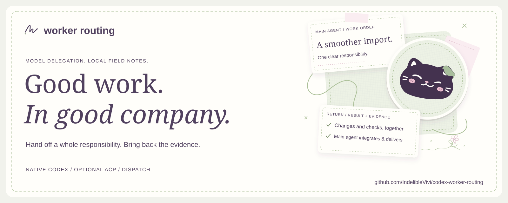
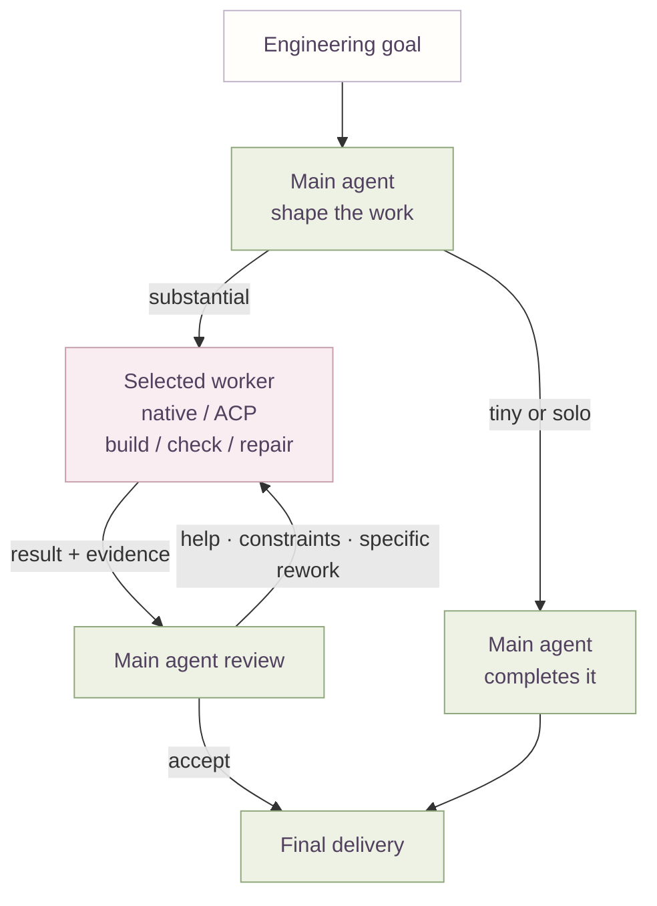

# Codex Worker Routing

[中文](README.md) | English

**Multi-model delegation for Codex: hand one complete engineering responsibility to a
worker, and keep the goal, judgment and final delivery with your main agent.**
CWR guides the main agent to identify a complete, independently deliverable responsibility
within substantial engineering work, using the operator's chosen native Codex or external
ACP channel. Workers investigate, build, check and repair together; when a key judgment is
needed, the main agent helps and returns the next step to the same worker. One default worker
is enough to start; tiny, nearly finished or solo work stays direct.

[Your first delegated task](docs/first-delegated-task.en.md) · [Install the plugin](#installation) ·
[Architecture overview](docs/architecture.en.md) · [Local Dispatch guide](docs/dispatch.en.md) ·
[Configure custom models](docs/native-model-picker.en.md)

## 0.4 series: what changed

Current source version: 0.4.2. Routing is provided by an instruction-only plugin; the
optional ACP integration connects a registered external coding agent through `acpx/runtime`;
and the optional main-session integration uses a native `SessionStart` hook to load local
private instructions automatically. There is no additional MCP server, job database,
provider proxy, or fixed planner/tester/reviewer pipeline. The 0.4 series shifts the emphasis
from component wiring to a worker that carries one whole responsibility end to end.

| Capability | Current 0.4 capabilities |
| --- | --- |
| Complete responsibility | The routing instruction treats an ordinary substantial goal as enough to identify one complete, delegable responsibility; the worker owns investigation, implementation, checks, repair and closeout. Solo or tiny work stays direct. |
| Same-worker help | A needed decision or capability goes back to the same child, with accepted results preserved and no default reviewer or mandatory takeover. |
| Bounded delivery | `--deliver` collects a worker's structured declaration and keeps it separate from the runtime receipt and its bounded text excerpt. |
| Finite batches | `prepare` turns one coordinator-authored spec into per-item orders and a manifest; `batch` runs a finite dependency graph in separate CLI processes with exact predecessor report/artifact bindings, `--start-handle` publishes the batch identity before launch and `--compact` gives a bounded paged terminal; `collect --job` expands one full record and `--impacts` one job's decision impacts. No global scheduler or job database. |
| Evidence boundaries | A worker declaration is a candidate, not acceptance; verification executes only task-confirmed checks, and never executes commands taken from a report. |
| Durable ACP authority | Every run/continue re-checks explicit per-turn permissions; recovery binds the exact session and receipt; configured fallback is pre-launch only. |

## How a task flows

The operator's standing channel choice comes first: available native tools do not override a
standing ACP selection. For a registered ACP route, add `routing.default` to the existing
private `routes.json` and ordinary runs can omit `--route`. After dispatch, the main agent does
not re-implement the same responsibility; a gap goes back to the same worker, and the main
agent keeps integration and final delivery.



## Everyday use

After installation, just ask for engineering work as usual. The main agent hands over a
complete responsibility when that pays off: investigation, implementation, self-testing and
the necessary documentation can be finished coherently by the same worker, and a correction
continues in the same child.

```text
Fix the CSV import failure caused by blank rows and add a reproducing check.
A worker can own investigation, the fix and self-checks for the import module;
you retain integration and final delivery.
```

`全权接住` and `从头做到位` permit internal delegation; `solo`, `亲自做`, and `别派小弟` keep the
main agent executing. Tiny work, nearly finished work, or work whose handover cost is too high
is completed directly as well. Delegation protects the complete result, its quality and the
applicable permissions first, then aims to reduce execution work on the main subscription without
sacrificing those three, while keeping end-to-end duration and coordinator rework under
control. Model and provider names stay in operator configuration; the plugin keeps no
leaderboards, price lookups, or evaluation matrices.

## Delivery, batches and recovery

Ordinary `run` / `continue` / `close` stays simple, with explicit per-turn permissions and no
extra bookkeeping. Complex outcomes can opt into `--deliver`, and finite dependent or independent lists
into `batch`. `prepare` mechanically assembles orders and a manifest and launches no worker;
`batch --start-handle` publishes the batch identity after the initial index exists and before
any child launches, so no caller scans the state directory; `collect` is read-only and
returns settled results at any time, `collect --compact` gives a whole-response byte-bounded
page, `collect --job` expands one full record from the index and `collect --impacts` one job's
decision impacts. A worker declaration is
`ready`, `partial` or `needs_input`: a candidate, never acceptance, and runtime completion is
not acceptance either. See [worker delivery and finite batches](docs/worker-delivery.en.md).

An explicit input binding sends the selected report text, artifact references and their
observations to the successor job's chosen route. Check that destination is authorized for
the material when authoring the batch; access to original artifacts needs its own scope.

Recovery keeps the exact session and receipt. Every ACP `run` / `continue`, including an
ordinary continuation, must pass `--permissions read|full`; omission is rejected before
dispatch. Once a timeout or cancellation is established, a late result cannot overwrite it,
and its output remains progress evidence. Configured fallback is tried only before launch, for
an unavailable executable or a missing required credential; permission, workspace,
disabled-route, initialization and execution failures do not trigger it. `enabled: false`
blocks later run/continue while status/cancel/close remain available, and a default change
affects new responsibilities only. See [ACP defaults and fallbacks](docs/acp-integration.en.md#defaults-and-fallbacks)
and [installation and recovery](docs/installation.en.md).
The task budget is a hard deadline that activity events cannot reset; receipts retain
minimal activity/timing evidence. Status can read a matching receipt persisted before an
interrupted binding update; display recovery never confirms cleanup or releases locks.

After two explicit reworks leave the same acceptance gap with no material progress, make a
recovery decision before a third equivalent order: repair a concrete environment problem,
narrow the remaining scope or take over part of the work. New requirements, phase transitions
and undelivered permissions are not quality failures.

## How context is separated

| Content | Main session | Temporary worker |
| --- | --- | --- |
| Shared engineering AGENTS and project rules | host-dependent; attached when the host provides them | host-dependent; attached when the host provides them |
| Local private main-session instructions | injected before the first model request by the optional SessionStart integration | not injected by that hook |
| The specific work order | organized by the main agent | received explicitly |
| Main conversation history | retained | new native work orders use `fork_turns="none"`; ACP runs a separate session with a minimal order |

Adding a separate worker AGENTS file does not remove the private rules the host has already
attached. To enable context separation, move the private content out of the automatically
shared AGENTS and first verify that the startup hook is trusted and arrives complete. This is
an input-assembly boundary, **not a file-access sandbox**. The model and reasoning effort are
determined by the user's live inventory and authorization; the plugin does not bind to a
vendor, provide API keys, change the main model, or use a trial run to request permission for
private data transfer.

## Dispatch

Dispatch is an optional, local, read-only projection of existing ACP receipts. It is not
needed to use Worker Routing, and it does not schedule work, add a job database, or show native
Codex activity; every metric is explicitly ACP-only. Once the
[optional ACP integration](#installation) is configured, launch it from the canonical
checkout:

```sh
node integrations/acpx/src/cli.mjs dashboard --config /absolute/private/routes.json
node integrations/acpx/src/cli.mjs stats --config /absolute/private/routes.json --since 7d
```

The command prints a private loopback URL (an ephemeral port unless you add `--port 4317`) and
runs in the foreground: open that URL yourself and keep the process running until you close
the panel or press Ctrl+C. Before your first ACP task the dashboard opens empty, since it only
projects receipts that already exist.

Home shows aggregate activity over time, route workload, explicit revisions and runtime notes;
Sessions replays one responsibility, and share cards export an aggregate allowlist plus your
own slogan and credit, named `worker-routing-THEME-LANGUAGE-FORMAT-DATE.ext`. It ships four
themes (sage cat, oat bunny, mist puppy, lilac bear) whose colours apply to the panel and charts
while the companion appears on the overview sticker and the share seal. Theme, language and
timezone are the only writeable display preferences, saved outside Git; Storage separately
offers explicit cleanup plans and confirmed application. The dashboard is loopback-only
and on demand, with no analytics or extra frontend dependency. Cumulative tokens are
deduplicated with explicit coverage, missing data stays unknown, and observed workload is not
an estimate of Codex quota saved. Commands, the export allowlist and the data contract are in
the [Dispatch guide](docs/dispatch.en.md).

Storage groups disk usage by worker home and category, distinguishing logical size from
estimated allocation. The `storage`, `storage-plan` and `storage-apply` CLI commands use the
same backend: preview changes no original data, and applying requires explicit confirmation
and fresh validation. Only manifest-owned session scratch with a normally closed binding
and confirmed execution cleanup can qualify. History, databases, logs and legacy tmp/cache
remain inspection only. See [storage management](docs/storage-management.en.md).

## Product page and banners

The bilingual product page carries the sage, blush paper and folded-ear cat identity into the
delegation guide and a synthetic Dispatch preview, with an interactive chart of daily worker
turns and downloadable sample share cards. The site does not connect to a private dashboard,
read receipts or use analytics. Visit the
[English product page](https://indeliblevivi.github.io/codex-worker-routing/) or
[中文版](https://indeliblevivi.github.io/codex-worker-routing/zh/); setup, Dispatch and
boundaries are in the [on-site usage guide](https://indeliblevivi.github.io/codex-worker-routing/guide/).
Local preview and publishing are in the [website guide](docs/website.en.md), and the English and
Chinese banners live in [`plugins/worker-routing/assets/`](plugins/worker-routing/assets/).

## Going deeper

[From zero to a first successful delegated task](docs/first-delegated-task.en.md) separates
model/provider access, native subagents, the Worker Routing plugin, the optional ACP route and
coordinator acceptance, then gives three independent setup paths and a troubleshooting table.
To add an API model to the native Codex model picker, use the
[custom native model picker guide](docs/native-model-picker.en.md); provider keys,
subscription priorities and concrete fallback choices stay in operator-owned configuration
outside Git. ACP route reachability has a separate protocol boundary, explained in
[the ACP channel and provider-protocol boundary](docs/acp-provider-protocols.en.md), and one
concrete end-to-end example is
[using the Command Code Provider API through Codex Router](docs/commandcode-via-codex-router.en.md).

## Installation

Open this repository in Codex and have the built-in plugin-creator install the plugin:

```text
Install this repository's plugins/worker-routing plugin into my personal
marketplace, and keep my current main model and provider configuration.
For updates, use the cachebuster and a normal reinstall.
```

After the personal marketplace registration is complete, the native commands are:

```bash
codex plugin add worker-routing@personal --json
codex plugin list --marketplace personal --json
```

To use an external ACP worker, install the optional integration:

```bash
cd integrations/acpx
npm ci --ignore-scripts
npm run check
npm run test:acpx
```

Keep route configuration, worker homes, adapters and account state outside Git; see the
[ACP integration guide](docs/acp-integration.en.md) for commands and boundaries. When private
instructions need to be separated, follow [installation and recovery](docs/installation.en.md)
to connect the startup hook. That integration is independent of the plugin; turning off the
routing plugin does not turn off main-session private instructions.

## Verification

The Python integration tests use only the standard library:

```bash
python3 -m unittest discover -s tests -p 'test_*.py'
python3 tests/native_context_probe.py --codex-bin "$(command -v codex)"

cd integrations/acpx
npm ci --ignore-scripts
npm run check
npm run test:acpx
```

The second command is an opt-in native process check and requires a binary that provides the
current multi-agent tools. It uses a temporary Codex home, synthetic instructions and a local
scripted Responses service to verify the first root request, the child's first work,
continuation of the same child, and interrupt after completion. It does not call a real model
and cannot replace acceptance with an actual provider and actual engineering execution. Codex
itself may still try to fetch public plugin metadata, so the process is not guaranteed to be
fully offline.

The initial native compatibility basis is Codex `0.154.0-alpha.6.2`. The ACP integration is
pinned and verified against `acpx@0.15.1` and requires Node.js 22.13 or newer. The real schema
and adapter capabilities still govern at call time, and older CLIs or other hosts may not
provide the same fields. See [input boundaries](docs/context.en.md) and the
[ACP integration guide](docs/acp-integration.en.md) for more limitations.

## Canonical source and scope

This repository is the independent canonical source. The shared worker contract, routing entry
and on-demand references under `plugins/worker-routing` are canonical in English. `acp-worker`
owns the optional channel operations; `swarm` owns authorized finite batches. The native
documents keep the trigger examples `全权接住`, `从头做到位`, `solo`, `亲自做`, and `别派小弟`.
Public setup, usage and boundary documents are available in Chinese and English, listed in the
[documentation index](docs/README.en.md), with the
[architecture overview](docs/architecture.en.md) explaining the topology. Runtime instructions
retain their canonical English text and exact command names.

**Provenance and scope.** This is an independently maintained, project-original workflow
project. Its initial routing policy was extracted by component scope from an internal
engineering workshop, and the independent repository is now the canonical source; the
workshop's Git history, adjacent projects, personal instructions, and working records were not
migrated. The repository contains hand-written routing and worker instructions, the native
SessionStart adapter, the installer, synthetic tests, user documentation, and an optional
integration built against the public `acpx/runtime` API. Responses and ACP test events are local
protocol fixtures with no real accounts, private requests, or model outputs; no Codex runtime
or external adapter implementation was copied. `acpx` and its transitive dependencies retain
their own third-party licenses. The interface references OpenAI's
[Hooks](https://learn.chatgpt.com/docs/hooks) and
[Subagents](https://learn.chatgpt.com/docs/agent-configuration/subagents) documentation and
independent observation of the local binary. This project is not an OpenAI official product or
a fork maintained by OpenAI.

**Privacy.** Personal instructions, account configuration, requests, and continuity are not
part of this repository. See [provenance](PROVENANCE.en.md).

## Related projects

For MCP engineering and everyday repository work.

- [MCP Boundary](https://indeliblevivi.github.io/mcp-boundary/):
  An MCP engineering skill with a Guide and Lab for designing, reviewing and verifying MCP servers and the apps that use them.
- [Servotab](https://servotab.com/):
  Engineering methods for repository planning, implementation, debugging, review and verification.

## Licensing

Software and functional material are licensed under [`SUL-1.0`](LICENSE), which permits
personal, noncommercial, and internal business use; distribution or provision to others must be
free of charge and noncommercial. Documentation is licensed under
[`CC BY-NC-SA 4.0`](LICENSE-DOCUMENTATION.md), allowing noncommercial sharing and adaptation
with attribution and ShareAlike. This project is source-available and is **not OSI open
source**. [`LICENSING.md`](LICENSING.md) is the canonical path-level map.

---

Co-created by [Faye](https://github.com/IndelibleVivi) & Cove. Made with care, together.
