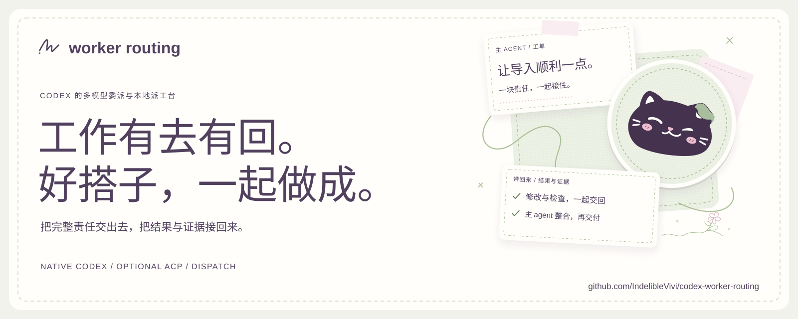
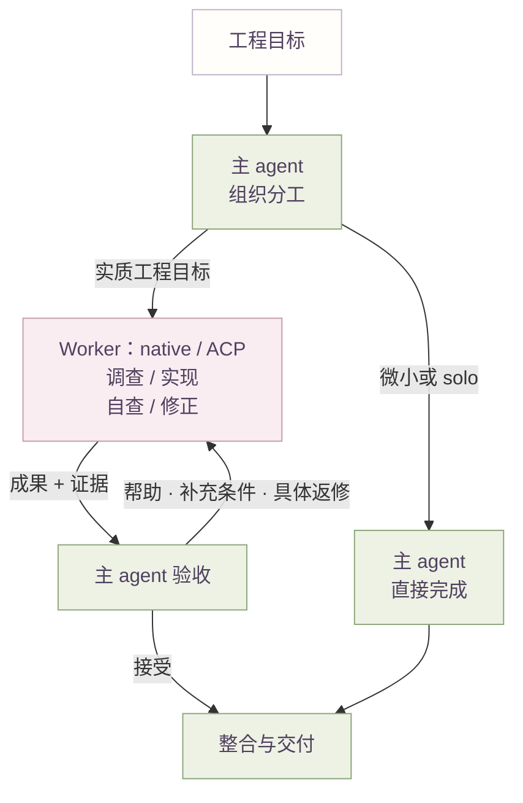

# Codex Worker Routing

[English](README.en.md) | 中文

**面向 Codex 的多模型委派工具：把完整的工程责任交给 worker，同时把目标、判断与最终交付留在
主 agent 手里。**
它指导主 agent 从实质工程目标中识别可独立交付的责任，沿用 operator 选择的原生 Codex
或外部 ACP 通道。worker 连贯调查、实现、自查与修正；需要关键判断时，主 agent 提供帮助，
再把下一步送回原 worker。一个默认小工就能开始，微小、临近完成或 solo 的工作直接做。

[从零到第一次成功派工](docs/first-delegated-task.md) · [安装插件](#安装) ·
[架构总览](docs/architecture.md) · [本地派工台使用指南](docs/dispatch.md) ·
[配置自定义模型](docs/native-model-picker.md)

## 0.4 系列：这次改变什么

当前源码版本为 0.4.2。调度由一个 instruction-only plugin 提供；可选 ACP integration 通过
`acpx/runtime` 连接已登记的外部 coding agent；可选的主会话集成使用原生 `SessionStart` hook
自动加载本机私人说明。没有额外 MCP、job database、provider proxy 或固定 planner/tester/reviewer
流水线。0.4 系列把重点从组件接线移到「一个能端到端背起整块责任」的 worker。

| 能力 | 0.4 的当前能力 |
| --- | --- |
| 完整责任 | 路由说明把实质工程目标视为足以识别一块完整、可委派责任；调查、实施、自检、自修与收尾都由 worker 负责。微小或 solo 工作仍直接完成。 |
| 同一 worker 协助 | 需要一次判断或某项能力时，答复回到同一个 child，保留已接受的结果，不默认另派 reviewer，也不强制接管。 |
| 有界交付 | `--deliver` 收集 worker 的结构化交付声明，与 runtime 回执及其有界文本摘录分开保存。 |
| 有限批次 | `prepare` 把一份主协调者撰写的 spec 机械生成逐条 order 与 manifest；`batch` 对有限清单做 admission 并以独立 CLI 进程执行，`--start-handle` 在启动前给出本批 identity，`--compact` 给出有界分页终态；`collect`（含 `--compact`）读取已结算结果，`--job` 可展开单条完整记录，不必等其余项目。没有全局 scheduler 或 job database。 |
| 证据边界 | worker 声明只是候选，不是验收；只有任务确认的检查会执行，绝不执行来自报告的指令。 |
| ACP 持久授权 | 每次 run/continue 都重查显式每轮权限；恢复绑定确切的 session 与回执；已配置的备用只在启动前触发。 |

## 一次任务怎样流动

先尊重 operator 已有的通道选择：可用的原生工具不覆盖常设 ACP 选择。对已登记的 ACP route，
在现有 Git 外 `routes.json` 加入 `routing.default`，普通 `run` 即可省略 `--route`。派出后主
agent 不重复实施同一责任；出现缺口就回到同一个 worker，主 agent 保留整合与交付。



## 日常使用

安装后正常提出工程任务即可。主 agent 在有收益时交出完整责任：调查、实现、自测和必要文档可以由
同一个 worker 连贯完成，需要修正时继续同一个 child。

```text
修复 CSV 导入时空行导致的失败，补能复现问题的检查。
可以把导入模块的调查、修复和自测交给一个 worker；你负责整合与交付。
```

`全权接住`、`从头做到位` 允许内部委派；`solo`、`亲自做`、`别派小弟` 保持主 agent 执行。
微小、接近完成或交接成本过高的工作也直接完成。派工顺序是先保住完整结果、质量与权限，再在不牺牲
这三者的前提下减少主订阅模型的执行消耗，同时控制端到端耗时与 coordinator 返工。模型与 provider
名留在 operator 配置里，插件不做排行榜、价格查询或评测矩阵。

## 交付、批次与恢复

日常 `run` / `continue` / `close` 保持简单，每轮显式权限，不要求额外记录。复杂成果可选
`--deliver`，有限独立清单可选 `batch`；`prepare` 机械生成 order 与 manifest 且不启动任何 worker，
`batch --start-handle` 在初始索引落盘后、启动任何子进程前给出本批 identity，不靠扫描 state 目录；
`collect` 只读并随时返回已结算结果，`collect --compact` 提供整份受字节预算约束的分页读取，
`collect --job` 按 job 展开索引里的完整记录。worker 声明为 `ready`、`partial` 或 `needs_input`，只是候选，
不是验收；runtime 完成同样不是验收。完整接口见
[Worker 交付与有限批次](docs/worker-delivery.md)。

恢复绑定确切的 session 与回执。每次 ACP `run` / `continue`（包括普通续做）都必须显式带
`--permissions read|full`，省略会在派工前被拒绝。超时或取消一旦成立，迟到的结果不会改写终态，
已有输出保留为进度证据。已配置的备用只在启动前因入口不可用或缺少必要环境凭据而触发；权限、
workspace、停用、初始化或执行失败都不会触发。`enabled: false` 阻止后续 run/continue，同时保留
status/cancel/close；更换默认只影响新责任。配置与恢复细节见
[ACP 默认与备用](docs/acp-integration.md#默认与备用)与[安装与恢复](docs/installation.md)。
任务预算是不会被活动事件刷新的 hard deadline；receipt 保存最小 activity/timing 证据。
status 可只读找回 binding 更新中断前已落盘的匹配回执，显示恢复不确认清理或解除锁。

同一验收缺口经过两次明确返修仍无实质进展时，第三次同样派工前必须重新决定恢复方式：修复具体
环境问题、缩小剩余责任或部分接管。新需求、阶段推进和未送达权限不计为质量失败。

## 上下文怎样分开

| 内容 | 主 session | 临时 worker |
| --- | --- | --- |
| 共享工程 AGENTS 与项目规则 | 依赖宿主，宿主提供时附加 | 依赖宿主，宿主提供时附加 |
| 本机私人主会话说明 | 可选 SessionStart 集成在首次模型请求前注入 | 不由该 hook 注入 |
| 具体工单 | 主 agent 组织 | 明确接收 |
| 主对话历史 | 保留 | 新原生工单使用 `fork_turns="none"`；ACP 使用独立 session 与最小工单 |

仅增加一份 worker AGENTS 不会移除宿主已附加的私人规则。启用上下文分离时，需要把私人内容移出
自动共享 AGENTS，并先验证启动 hook 已受信任且完整送达。这属于输入装配边界，**不是文件访问
sandbox**。模型和 reasoning effort 由使用者的实时库存与授权决定；插件不绑定供应商、不提供
API key、不改变主模型，也不通过试跑申请私人数据传输权限。

## Dispatch · 派工台

Dispatch 是可选的本地派工台，对已有 ACP 回执做只读投影——不使用它不影响 Worker Routing；
它不安排工作、不建 job database，也没有原生 Codex 活动的数据源（页面数字明确只覆盖 ACP）。
配置好[可选的 ACP integration](#安装)后，在 canonical checkout 中启动：

```sh
node integrations/acpx/src/cli.mjs dashboard --config /absolute/private/routes.json
node integrations/acpx/src/cli.mjs stats --config /absolute/private/routes.json --since 7d
```

命令会在前台运行并打印一个私人 loopback URL（默认随机端口，可用 `--port 4317` 固定）；需要你
自己打开这个 URL，并保持进程运行，直到点击关闭面板或按 Ctrl+C。第一次派发 ACP 任务之前，派工台
打开时是空的，这是预期行为——它只投影已经存在的回执。

Home 显示聚合的按时间走势、route 分工、明确返修与 runtime notes；Sessions 回放单块责任。分享卡
导出聚合白名单加上你自己填写的文案与署名，文件名形如
`worker-routing-THEME-LANGUAGE-FORMAT-DATE.ext`。面板提供四套纸张配色（鼠尾草猫、燕麦玫瑰兔、
雾蓝奶油狗、薰衣草杏熊），配色应用到面板与图表，陪伴动物出现在首页标签与分享图圆章。主题、语言
和时区是仅有的可写偏好，保存在 Git 外；派工台仅监听 loopback、按需运行，没有 analytics 或额外
frontend dependency。累计 tokens 去重并标明用量覆盖率，缺少数据保持未知；观察到的工作量不是
节省 Codex 额度的估算。命令、导出白名单与数据契约见[派工台使用指南](docs/dispatch.md)。

## 产品页面与 Banner

双语产品页把鼠尾草、浅粉卡纸与折耳猫圆章带进委派指南和一份合成 Dispatch 预览，含可点选的逐日
轮次柱状图与可下载的示例分享卡。页面不连接私人派工台，不读取回执，不使用 analytics。访问
[中文产品页](https://indeliblevivi.github.io/codex-worker-routing/zh/)或
[English](https://indeliblevivi.github.io/codex-worker-routing/)；安装、Dispatch 与边界说明可在
[站内使用指南](https://indeliblevivi.github.io/codex-worker-routing/zh/guide/)阅读。本地预览与
发布方法见[产品页面指南](docs/website.md)，中英 Banner 位于
[`plugins/worker-routing/assets/`](plugins/worker-routing/assets/)。

## 深入了解

[从零到第一次成功派工](docs/first-delegated-task.md)把 model/provider、native subagent、
Worker Routing plugin、可选 ACP route 和最终验收分成五层，并给出三条可独立采用的路线与排错表。
要把自有 API model 放进 Codex native model picker，见[自定义 native model picker](docs/native-model-picker.md)；
provider、key、套餐优先级和具体 fallback 选择始终留在 operator 的 Git 外配置里。ACP route 的
可达性另有协议边界，见[ACP 通道与 provider 协议边界](docs/acp-provider-protocols.md)；一个具体的
端到端例子见[经 Codex Router 使用 Command Code Provider API](docs/commandcode-via-codex-router.md)。

## 安装

在 Codex 中打开本仓库，让内置 plugin-creator 安装插件：

```text
请把本仓库 plugins/worker-routing 安装到我的 personal marketplace，
保持当前主模型和 provider 配置。更新时使用 cachebuster 与正常 reinstall。
```

完成 personal marketplace 注册后，原生命令是：

```bash
codex plugin add worker-routing@personal --json
codex plugin list --marketplace personal --json
```

需要外部 ACP worker 时，再安装可选 integration：

```bash
cd integrations/acpx
npm ci --ignore-scripts
npm run check
npm run test:acpx
```

route config、worker home、adapter 与账号状态留在 Git 外；具体命令和边界见
[ACP integration](docs/acp-integration.md)。需要分离私人说明时，再按[安装与恢复](docs/installation.md)
接入启动 hook。该集成独立于 plugin；关闭派工 plugin 不会关闭主会话私人说明。

## 验证

Python 集成仅使用标准库：

```bash
python3 -m unittest discover -s tests -p 'test_*.py'
python3 tests/native_context_probe.py --codex-bin "$(command -v codex)"

cd integrations/acpx
npm ci --ignore-scripts
npm run check
npm run test:acpx
```

第二条是 opt-in 原生进程检查，要求 binary 提供当前 multi-agent 工具。它使用临时 Codex home、
合成说明和本机 scripted Responses 服务，验证首次 root 请求、child 首次工作、同一 child 续做及
完成后 interrupt。它不调用真实模型，也不能代替实际供应商与工程执行验收。Codex 自身可能仍尝试
获取公共插件元数据，进程不保证完全离线。

初始 native 兼容性依据为 Codex `0.154.0-alpha.6.2`；ACP integration 固定验证 `acpx@0.15.1`，
要求 Node.js 22.13 或更高。调用时仍以真实 schema 与 adapter 能力为准，较旧的 CLI 或其他宿主
未必提供相同字段。更多限制见[输入边界](docs/context.md)与[ACP integration](docs/acp-integration.md)。

## 独立真源与范围

本仓库是独立 canonical source。`plugins/worker-routing` 的共同角色契约、协调入口和按需
references 以英文为 canonical text；`acp-worker` 负责可选通道调用，`swarm` 负责已授权有限批次。
native 说明保留 `全权接住`、`从头做到位`、`solo`、`亲自做`、`别派小弟` 等触发示例。公开安装、
使用与边界文档提供中英文版本，见[文档目录](docs/README.md)，[架构总览](docs/architecture.md)
说明整体拓扑。Runtime 说明保留英文真源与原始命令名。

**来源与范围。** 这是一个独立维护、项目原创的流程项目。初始路由策略按组件范围从一次内部工程
工作坊中提取，独立仓库现为 canonical source；工作坊的 Git 历史、相邻项目、私人说明和工作记录
均未迁入。仓库包含手写的路由与 worker 说明、原生 SessionStart adapter、installer、合成测试、
使用者文档，以及一套基于公开 `acpx/runtime` API 的可选 integration。Responses 与 ACP 测试事件
是本地协议 fixture，不含真实账号、私人请求或模型输出；没有复制任何 Codex runtime 或外部 adapter
实现。`acpx` 及其传递依赖保留各自的第三方许可。界面参考 OpenAI 的
[Hooks](https://learn.chatgpt.com/docs/hooks) 与
[Subagents](https://learn.chatgpt.com/docs/agent-configuration/subagents) 文档以及对本机 binary
的独立观察。本项目不是 OpenAI 官方产品，也不是由 OpenAI 维护的 fork。

**隐私。** 私人说明、账号配置、请求与 continuity 不属于本仓库。见[来源说明](PROVENANCE.md)。

## 相关项目

面向 MCP 工程与日常仓库工作。

- [MCP Boundary](https://indeliblevivi.github.io/mcp-boundary/zh/)：
  一套 MCP 工程技能，附 Guide 与 Lab，用于设计、评审与验证 MCP server 与会用 MCP 的应用。
- [Servotab](https://servotab.com/)：
  一套工程方法，覆盖仓库规划、实现、调试、评审与验证。

## 许可

软件与功能材料采用 [`SUL-1.0`](LICENSE)：允许个人、非商业和企业内部使用；对外分发或提供必须
免费且非商业。文档采用 [`CC BY-NC-SA 4.0`](LICENSE-DOCUMENTATION.md)：允许署名后的非商业分享
与改编，公开改编须保持相同许可。本项目是 source-available，**不是 OSI open source**。具体文件
范围以 [`LICENSING.md`](LICENSING.md) 为准，另有[中文许可说明](docs/licensing.zh-CN.md)。

---

[Faye](https://github.com/IndelibleVivi) & Cove 共同创作。一点巧思，一起做成。
