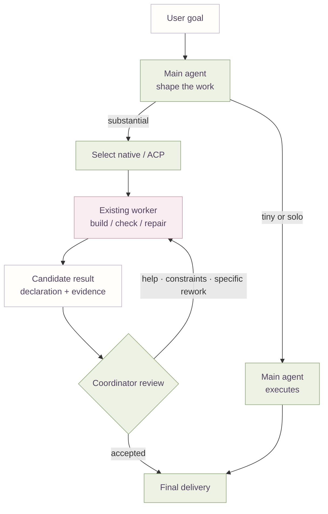
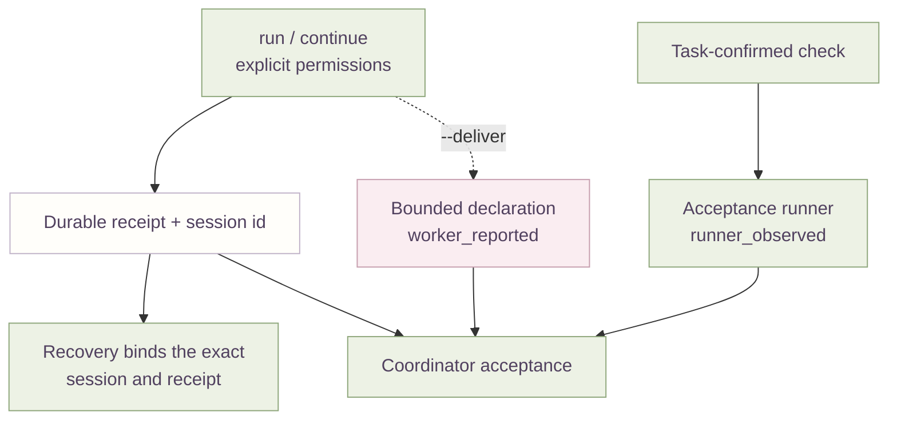

# Architecture

[中文](architecture.md) | English

This page explains who owns what, how one piece of work moves between them, and where the
optional ACP channel fits. It describes this repository's source and policy, not a promise
of stable model behaviour, and it makes no claim about quota savings or rework rates.

The design keeps two layers apart. The main agent's judgment, and the human instructions it
follows, are model-driven. The ACP integration is deterministic code: it assembles input,
keeps a durable session, records receipts and enforces configured boundaries. It never
decides product meaning for the user, and it is not a router or scheduler beyond the
configured route and its local batch admission.

## Ownership

| Owner | Surface | Responsibility |
| --- | --- | --- |
| Main coordinating agent | the user's Codex session | Owns the goal, product judgment, integration, acceptance and final delivery; picks the channel and scope within operator authorization. |
| Worker Routing plugin | `plugins/worker-routing/` | Instruction-only delegation and channel policy plus the shared worker contract. No daemon, job database, MCP server or provider proxy. |
| Temporary worker (native or external ACP) | one work order | A complete bounded responsibility: investigate, implement if authorized, check, repair, close out and return evidence. It does not re-route. |
| Optional ACP integration | `integrations/acpx/` | Deterministic transport: session, lifecycle, explicit per-turn permissions, receipts, bounded delivery and a task-confirmed verification runner. |
| Optional main-session integration | `integrations/main-session/` | Input assembly only: injects private instructions before the root's first model request. |
| Local Dispatch | `integrations/acpx/` (optional) | Read-only projection of existing ACP receipts. |

## Active work and feedback

The routing instruction treats an ordinary substantial goal as enough to identify one
complete, delegable responsibility; no operational keyword is required, and the operator's
standing channel choice decides native versus ACP. A whole responsibility means the worker
investigates, implements, checks, repairs and closes out by itself. When it needs one decision
or an unavailable capability, the answer returns to the same worker rather than a takeover.
Tiny, nearly finished or explicit solo work stays with the main agent. The diagram below
separates channel selection from the feedback path, so a return never re-runs selection.

Acceptance is the coordinator's. A worker declaration, a completed runtime and a check
result are distinct facts, and a stale, missing or conflicting one cannot become
acceptance. For a finite batch, acceptance starts from coverage, key claims, conflicts and
the integrated final state rather than rereading every source.

## Optional ACP mechanics

ACP is optional and coexists with native delegation. When the operator's default or the
current task selects a registered route, the `acp-worker` skill drives the canonical CLI:
`run` creates one responsibility, `continue` resumes the exact session, and every call
carries an explicit `read` or `full` permission. `routing.default` and `routing.fallbacks`
live in the operator's private config outside Git; the plugin ships no route, price or
model policy.

Two coordination aids stay off the ordinary path. `prepare` turns one coordinator-authored
spec into per-item orders and a manifest and launches no worker; `batch` admits the finite
list and runs it as independent CLI subprocesses, with `--start-handle` publishing the batch
identity after the initial index exists and before any launch, and `--compact` giving a
byte-bounded paged terminal; `collect` reads the results already published to the durable
index without waiting for the rest, `--compact` pages a bounded read and `--job` expands one
full record. Admission is local to one batch, so there is no global scheduler and no
cross-entrypoint safety claim.

### Durable authority and recovery

Authority binds to the exact session, not to a route name. Continuation re-checks the
original cwd, the versioned execution identity and the current permission ceiling on every
turn; a default change affects new work only, while disabling a route blocks later
run/continue and leaves status/cancel/close available. Configured fallback is pre-launch
only, for an unavailable executable or a missing required credential. Once a timeout or
cancellation is established, a late result cannot overwrite it. Recovery reconciles the
exact writer and receipt and preserves artifacts; a healthy or uncertain state is not a
reason to launch duplicate work.

Bounded delivery is collected only when the coordinator opts in with `--deliver`, and it
stays separate from the runtime receipt. A declaration is `ready`, `partial` or
`needs_input`, and its checks keep `worker_reported` provenance. Only the verification
runner creates `runner_observed` facts, from an explicit task environment, and it never
executes a command taken from a report.

## Input boundary

Input assembly depends on the host and the channel. Native and ACP workers receive the host's
engineering AGENTS and project rules only when the host attaches them, so that attachment is
host-dependent rather than guaranteed. A new native work order sets `fork_turns="none"` so it
does not carry the main conversation; an ACP worker is a separate session reached with a
minimal work order, not that flag. The optional main-session integration injects private
instructions before the root's first model request, and the hook does not inject them into a
child. A short order and `fork_turns="none"` still do not prove the host attached no
instructions, tools or other context. This is input assembly, not a file-access sandbox.
Route configuration, worker homes, adapters and account state stay outside Git.

## Source pointers

| Node or edge | Source |
| --- | --- |
| Delegation and channel policy | [worker-routing SKILL](../plugins/worker-routing/skills/worker-routing/SKILL.md) |
| Shared worker contract, delivered every ACP turn | [worker-contract](../plugins/worker-routing/skills/worker-routing/references/worker-contract.md) |
| Worker role and handoff/rework semantics | [worker-role](../plugins/worker-routing/skills/worker-routing/references/worker-role.md), [handoff](../plugins/worker-routing/skills/worker-routing/references/handoff.md) |
| ACP call surface | [acp-worker SKILL](../plugins/worker-routing/skills/acp-worker/SKILL.md) |
| ACP recovery | [recovery](../plugins/worker-routing/skills/acp-worker/references/recovery.md) |
| Finite batch method | [swarm SKILL](../plugins/worker-routing/skills/swarm/SKILL.md), [batch](../plugins/worker-routing/skills/swarm/references/batch.md) |
| Order spec to orders and manifest | [prepare.mjs](../integrations/acpx/src/prepare.mjs) |
| Finite batch admission and collection | [batch.mjs](../integrations/acpx/src/batch.mjs) |
| Bounded delivery collection | [delivery.mjs](../integrations/acpx/src/delivery.mjs) |
| Task-confirmed acceptance check | [verify.mjs](../integrations/acpx/src/verify.mjs) |
| Private route default/fallback config | [config.mjs](../integrations/acpx/src/config.mjs) |
| Optional SessionStart injection | [main-session/](../integrations/main-session/) |
| Read-only receipt projection | [dispatch.mjs](../integrations/acpx/src/dispatch.mjs), [dashboard.mjs](../integrations/acpx/src/dashboard.mjs) |

See [worker delivery and finite batches](worker-delivery.en.md), the
[ACP integration guide](acp-integration.en.md) and [input boundaries](context.en.md) for
the operational detail.

[Back to the project](../README.en.md)
