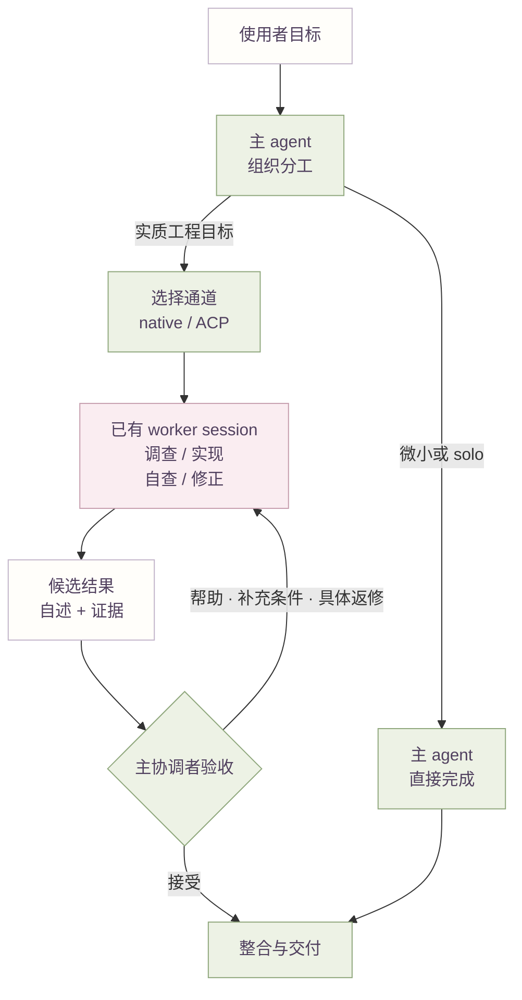
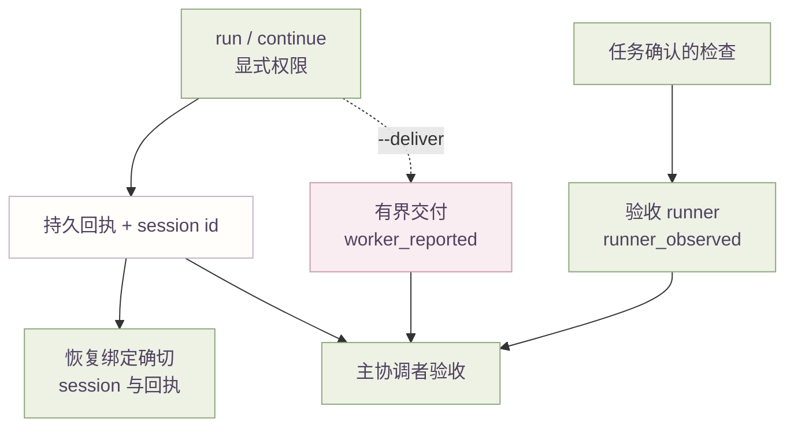

# 架构总览

中文 | [English](architecture.en.md)

本页说明谁负责什么、一块工作怎样在它们之间流动，以及可选的 ACP 通道落在哪里。它描述
本仓库的源码与 policy，不保证模型行为稳定，也不对节省 quota 或返工率作结论。

设计把两层分开。主 agent 的判断、以及它遵循的人为说明，由模型驱动；ACP integration 是
确定性代码：装配输入、维持持久 session、记录回执并执行已配置的边界。它不替使用者决定
产品含义，也不是超出已配置 route 与本批 admission 之外的 router 或 scheduler。

## 责任归属

| 角色 | 作用面 | 责任 |
| --- | --- | --- |
| 主协调 agent | 使用者的 Codex session | 掌握目标、产品判断、整合、验收与最终交付；在 operator 授权内选择通道与范围。 |
| Worker Routing plugin | `plugins/worker-routing/` | 只提供 instruction 的委派与通道 policy，以及共同 worker 契约。没有 daemon、job database、MCP server 或 provider proxy。 |
| 临时 worker（native 或外部 ACP） | 一份工单 | 一块完整的受限责任：调查、按授权实施、自检、自修、收尾并返回证据。它不再路由。 |
| 可选 ACP integration | `integrations/acpx/` | 确定性传输：session、生命周期、每轮显式权限、回执、有界交付与任务确认的验证 runner。 |
| 可选主会话集成 | `integrations/main-session/` | 只做输入装配：在 root 首次模型请求前注入私人说明。 |
| 本地 Dispatch | `integrations/acpx/`（可选） | 对已有 ACP 回执的只读投影。 |

## 工作与反馈

路由说明把实质工程目标视为足以识别一块完整、可委派责任；不需要任何操作关键词，由 operator
的常设通道选择决定 native 还是 ACP。完整责任意味着 worker 自行调查、实施、自检、自修与收尾。
需要一次判断或缺少某项能力时，答复回到同一个 worker，而不是接管责任。微小、接近完成或明确
solo 的工作留在主 agent。下图把通道选择与反馈路径分开，续做不会再次经过选择。

验收属于主协调者。worker 自述、runtime 完成与检查结果分别是不同事实，缺失、过期或相互
冲突的任何一项都不能成为验收。有限批次从不重查每份来源开始，而是先看覆盖、关键结论、
冲突与整合后的最终状态。

## 可选 ACP 机制

ACP 是可选的，并与 native 委派并存。当 operator 的默认或当前任务选择了一个已登记 route 时，
`acp-worker` skill 驱动 canonical CLI：`run` 建立一块责任，`continue` 恢复那个确切的 session，
每次调用都显式带 `read` 或 `full` 权限。`routing.default` 与 `routing.fallbacks` 位于 Git 外
的 operator 私人配置；插件不分发 route、价格或模型 policy。

两项协调辅助不进入日常路径。`prepare` 把一份主协调者撰写的 spec 机械生成逐条 order 与一份
manifest，不启动任何 worker；`batch` 对这份有限清单做 admission，并以独立 CLI 子进程执行；
`batch --start-handle` 在初始索引落盘后、启动任何子进程前给出本批 identity，`batch
--compact` 给出整份受字节预算约束的分页终态；`collect` 读取已发布到持久索引的结果，
`collect --compact` 做分页有界读取、`collect --job` 展开单条完整记录，都不必等其余项目
结束。admission 只作用于本批，因此没有全局 scheduler，也不宣称跨入口的并发安全。

### 持久授权与恢复

授权绑定到确切的 session，而不是 route 名。续做每轮都会重查原始 cwd、版本化执行身份与当前
权限上限；更换默认只影响新工作，停用 route 会阻止后续 run/continue，同时保留
status/cancel/close。已配置的备用只在启动前，因入口不可用或缺少必要环境凭据而触发。超时或
取消一旦成立，迟到的结果不能改写终态。恢复会对照确切的 writer 与回执并保留成果；健康或
状态不明的执行都不是重复启动的理由。

有界交付只在主协调者用 `--deliver` 明确选择时收集，并与 runtime 回执分开保存。交付声明为
`ready`、`partial` 或 `needs_input`，其检查保留 `worker_reported` 来源。只有验证 runner 会在
明确的任务环境中产生 `runner_observed` 事实，并且绝不执行来自报告的指令。

## 输入边界

输入装配取决于宿主与通道。原生或 ACP worker 只有在宿主附加时才会收到宿主的工程 AGENTS 与
项目规则，因此这项附加是依赖宿主、而非普遍保证的。新的原生工单设置 `fork_turns="none"`，
因此不携带主对话；ACP worker 是另一个 session，通过一份最小工单进入，不使用该 flag。可选的
主会话集成在 root 首次模型请求前注入私人说明，hook 不会把它注入 child。简短工单与
`fork_turns="none"` 仍不能证明宿主没有附加其他 instructions、tools 或 context。这属于输入
装配，不是文件访问 sandbox。route 配置、worker home、adapter 与账号状态都留在 Git 外。

## 源码指针

| 节点或边 | 源码 |
| --- | --- |
| 委派与通道 policy | [worker-routing SKILL](../plugins/worker-routing/skills/worker-routing/SKILL.md) |
| 每次 ACP 轮次都送达的共同 worker 契约 | [worker-contract](../plugins/worker-routing/skills/worker-routing/references/worker-contract.md) |
| worker 角色与交接/返修语义 | [worker-role](../plugins/worker-routing/skills/worker-routing/references/worker-role.md)、[handoff](../plugins/worker-routing/skills/worker-routing/references/handoff.md) |
| ACP 调用面 | [acp-worker SKILL](../plugins/worker-routing/skills/acp-worker/SKILL.md) |
| ACP 恢复 | [recovery](../plugins/worker-routing/skills/acp-worker/references/recovery.md) |
| 有限批次方法 | [swarm SKILL](../plugins/worker-routing/skills/swarm/SKILL.md)、[batch](../plugins/worker-routing/skills/swarm/references/batch.md) |
| order spec 生成 order 与 manifest | [prepare.mjs](../integrations/acpx/src/prepare.mjs) |
| 有限批次 admission 与收集 | [batch.mjs](../integrations/acpx/src/batch.mjs) |
| 有界交付收集 | [delivery.mjs](../integrations/acpx/src/delivery.mjs) |
| 任务确认的验收检查 | [verify.mjs](../integrations/acpx/src/verify.mjs) |
| Git 外私人 route 默认/备用配置 | [config.mjs](../integrations/acpx/src/config.mjs) |
| 可选 SessionStart 注入 | [main-session/](../integrations/main-session/) |
| 只读回执投影 | [dispatch.mjs](../integrations/acpx/src/dispatch.mjs)、[dashboard.mjs](../integrations/acpx/src/dashboard.mjs) |

操作细节见 [Worker 交付与有限批次](worker-delivery.md)、
[可选 ACP 执行通道](acp-integration.md)与[输入边界](context.md)。

[返回项目首页](../README.md)
